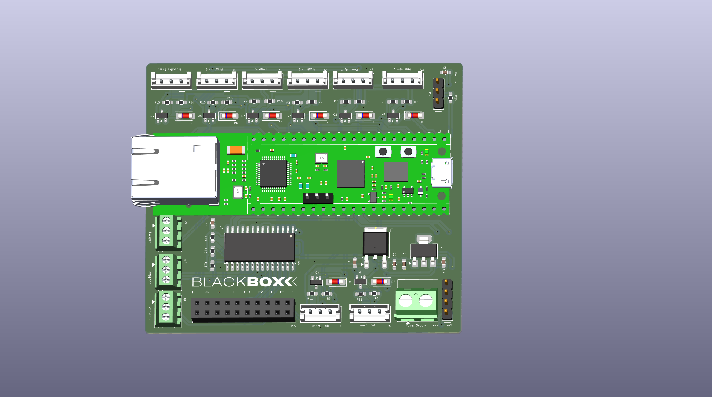
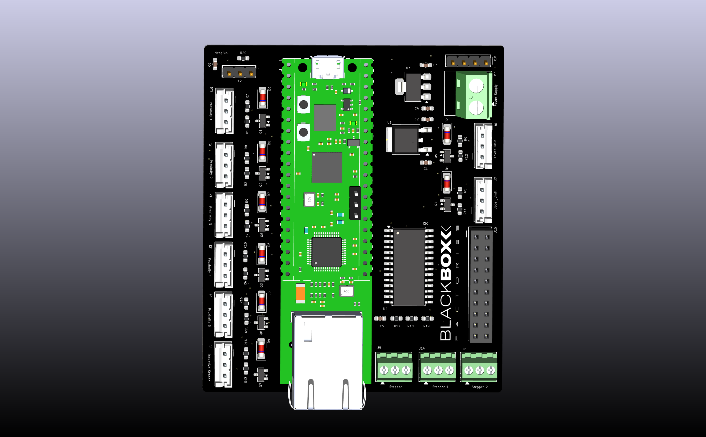

# Carrier Tray Loader / Unloader Controller

An RP2040-based industrial PCB designed to automate carrier tray handling for PnP machines — eliminating the need for a human operator to manually feed and collect trays during production runs.


## The Problem

PnP machines require a continuous supply of carrier trays to place components into. Without automation, an operator must stand at the machine full-time — manually loading empty trays one by one and collecting filled ones. This is wasteful, error-prone, and ties up a person for the entire production run.

## The Solution

This controller board powers two machines that work together:

**Loader** — Operator loads a stack of 5–10 empty trays at once. The machine automatically feeds one tray at a time onto the conveyor when the pick-and-place machine is ready, then steps down to the next tray in the stack.

**Unloader** — Collects filled trays returning from the PnP machine, stacks them, and steps up to make room for the next incoming tray — building a neat stack of completed trays without any human intervention.

## How It Works

```
        [Loader Stack]                    [Unloader Stack]
        ┌──────────┐                      ┌──────────┐
        │  Tray 5  │                      │  Tray 5  │ ← collecting
        │  Tray 4  │                      │  Tray 4  │
        │  Tray 3  │   → conveyor →       │  Tray 3  │
        │  Tray 2  │                      │  Tray 2  │
        │  Tray 1  │ ← feeding out        │  Tray 1  │
        └──────────┘                      └──────────┘
        Stepper: X (in/out)               Stepper: X (in/out)
        Stepper: Z (up/down)              Stepper: Z (up/down)
```

- **X-axis stepper** — pushes tray out onto conveyor (loader) / pulls tray in from conveyor (unloader)
- **Z-axis stepper** — moves platform up or down to align next tray with conveyor height
- **Proximity sensors** — detect tray presence at feed/collect position
- **Inductive sensors** — detect platform position for homing and limit detection
- **24V digital inputs** — industrial-standard signal levels for all sensors

## Hardware

| Parameter | Value |
|---|---|
| Microcontroller | RP2040 (Dual-core Arm Cortex-M0+, 133 MHz) |
| Digital Inputs | 24V industrial standard (proximity + inductive sensors) |
| Digital Outputs | Stepper motor driver signals |
| Motion axes | X (tray in/out), Z (platform up/down) |
| Tray capacity | 5–10 trays per load |
| EDA Tool | KiCad |

## Sensors Used

- **Proximity sensors** — tray presence detection at feed and collect positions
- **Inductive sensors** — metal platform position detection, homing, and end-stop limits

## Board Images




## Repository Structure

```
├── README.md
├── .gitignore
├── Carrier_traySchematic.kicad_pro     # Main project file
├── Carrier_traySchematic.kicad_sch     # Schematic
├── Carrier_traySchematic.kicad_pcb     # PCB layout
├── Carrier_traySchematicPCB.kicad_pro  # PCB project file
├── Carrier_traySchematicPCB.kicad_pcb  # PCB layout variant
├── CTG-Topview.png                     # Board top view render
└── CTG-frontview.png                   # Board front view render
```

## Getting Started

1. Install [KiCad](https://www.kicad.org/) (v7+ recommended)
2. Clone this repository:
   ```bash
   git clone https://github.com/Poornimakulkarni26/loader-unloader-pcb.git
   ```
3. Open `Carrier_traySchematic.kicad_pro` in KiCad

## Key Design Decisions

- **RP2040 chosen** for its dual-core architecture — one core handles motion control timing, the other handles sensor polling and logic, keeping stepper pulses jitter-free
- **24V DI inputs** to interface directly with standard industrial sensors without extra signal conditioning boards
- **Dedicated stepper outputs** for independent X and Z axis control with configurable microstepping

## Impact

- Eliminated full-time operator requirement at loader/unloader stations
- Allows batch loading of 5–10 trays, freeing the operator for other tasks
- Consistent tray feeding speed improves Pnp throughput
- Reduced tray misalignment errors compared to manual feeding

## Author

**Poornima Kulkarni**
Embedded Systems & Industrial Automation Engineer

- GitHub: [@Poornimakulkarni26](https://github.com/Poornimakulkarni26)

## License

This project is open-source under the [MIT License](LICENSE).
